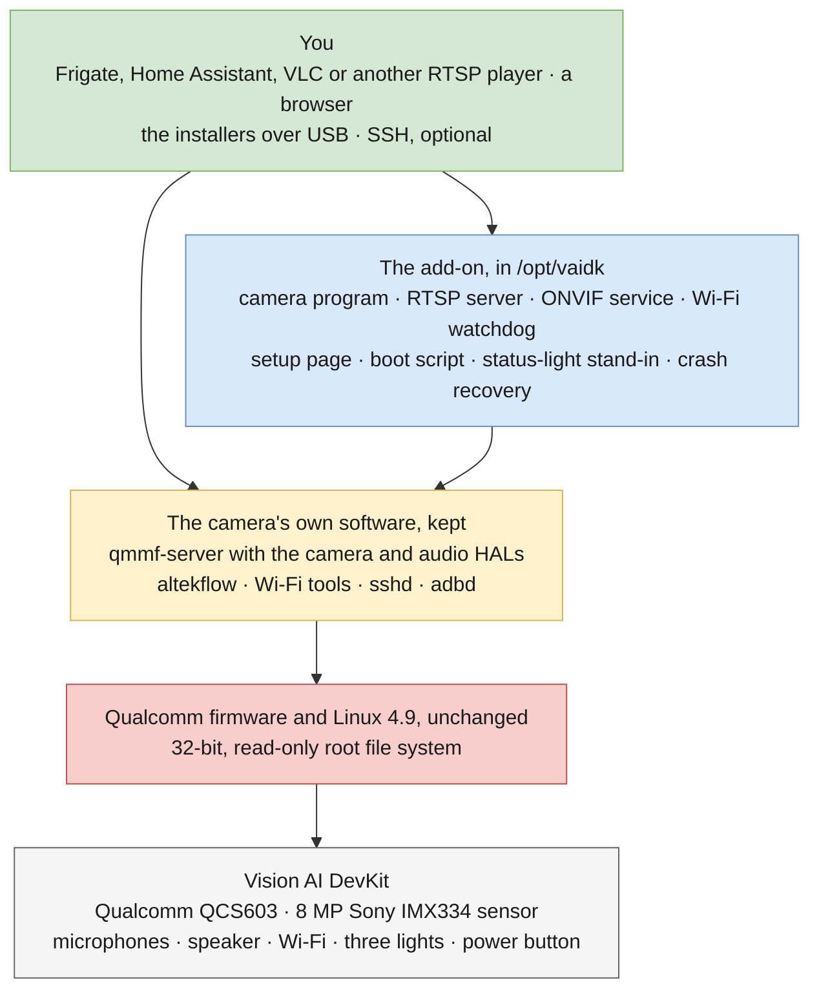
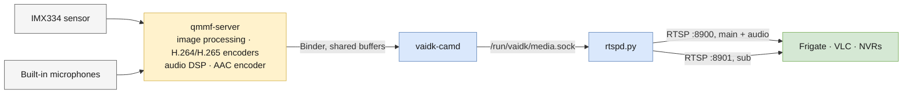
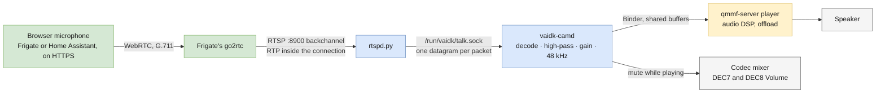
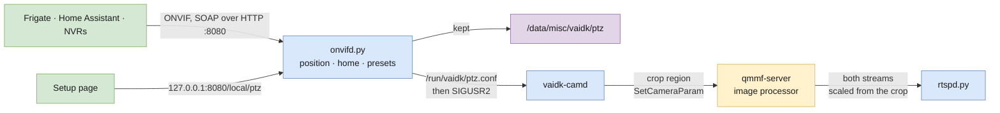
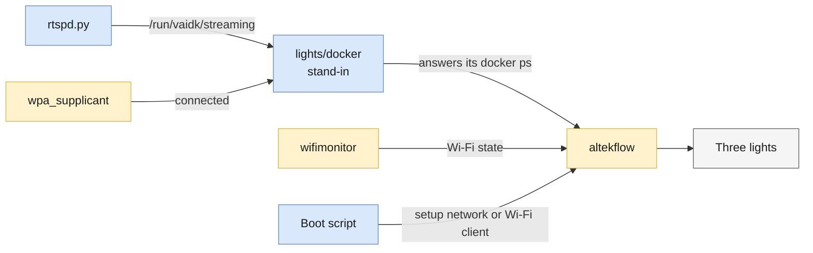
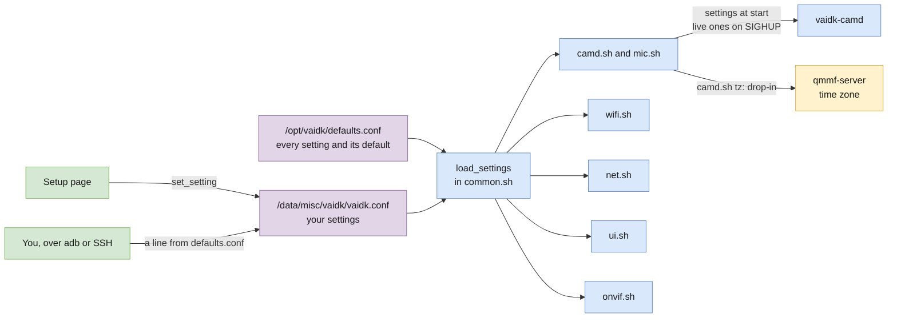
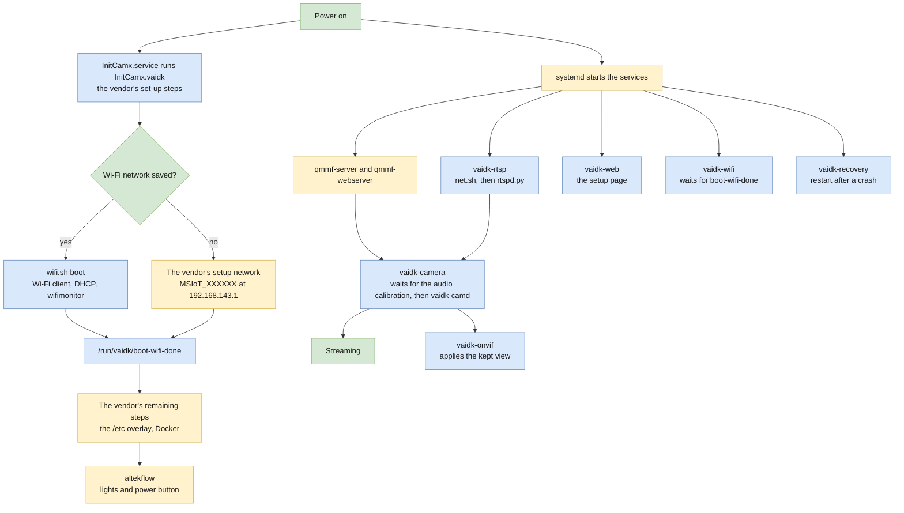
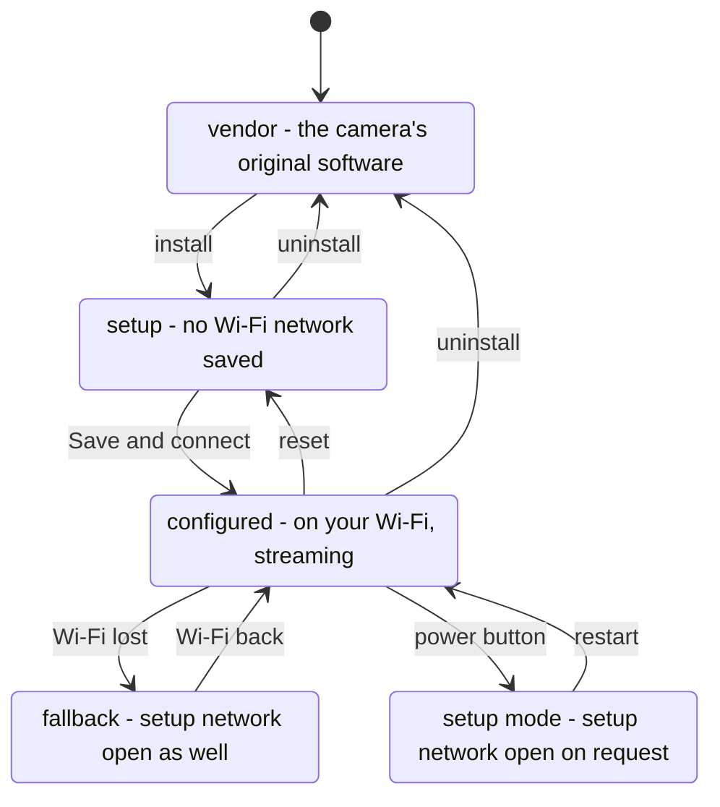
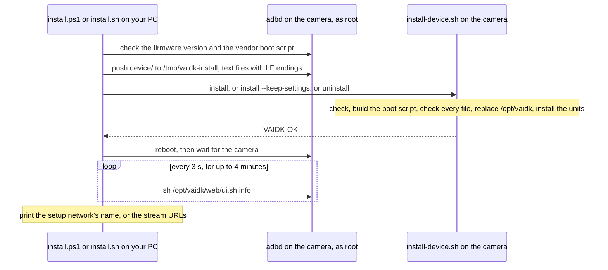

# Architecture: how the add-on fits together

This document shows how the pieces work together: the layers, how video, audio, talk-back, pan, tilt
and zoom, and status flow between the parts, how settings reach them, how the camera boots, and how
the add-on is installed, set up and removed.
- What the project is for, and how to use it: [README.md](README.md).
- The camera as it came: [ASSESSMENT.md](ASSESSMENT.md).
- How each feature was made to work without Azure, and where every piece comes from:
  [PROVENANCE.md](PROVENANCE.md).
- Each component in detail: its own README, linked from [Components](#components).

## Contents

1. [The layers](#the-layers)
2. [Components](#components)
3. [How data flows](#how-data-flows)
4. [Settings: one file, two ways to change it](#settings-one-file-two-ways-to-change-it)
5. [Boot](#boot)
6. [Install, setup and reset](#install-setup-and-reset)
7. [Network ports](#network-ports)
8. [Repository layout](#repository-layout)

## The layers



- **Hardware.** The camera board, its sensor, microphones, speaker, Wi-Fi, lights and power button.
  [ASSESSMENT.md](ASSESSMENT.md) lists it all.
- **Firmware and kernel.** Qualcomm's boot chain, Linux 4.9, and the firmware of the image
  processor, the video encoder and the DSPs, as the camera shipped them. The add-on never touches
  them.
- **The camera's own software.** `qmmf-server` runs the sensor, the image processor, the video
  encoders, the microphones and the speaker; `altekflow` drives the lights and the power button; the
  vendor's Wi-Fi tools run the Wi-Fi client and the setup network. The add-on uses them as they are,
  and changes a few things around them: its own copy of the boot script runs instead of the
  vendor's, the vendor preview server is disabled, `qmmf-server` gets a time zone, and the admin
  account is an ordinary Linux user.
- **The add-on.** Six systemd services and the boot script, in `/opt/vaidk`. Your settings are in
  `/data/misc/vaidk`.
- **You.** RTSP players and NVRs, a browser for the setup page, the installers over USB, and SSH if
  you want it.

## Components

| Component | Runs as | What it does | Details |
|---|---|---|---|
| Boot script | `InitCamx.service`, through a drop-in | The vendor's boot sequence without its IoT Hub step: joins the saved Wi-Fi network, or opens the setup network | [device/boot](device/boot/README.md) |
| Camera program | `vaidk-camera.service` | `vaidk-camd` drives the camera, the encoders, the microphone and the speaker through `qmmf-server`, and applies the picture settings and on-screen text | [device/camera](device/camera/README.md), [camd](camd/README.md) |
| RTSP server | `vaidk-rtsp.service` | `rtspd.py`: the main stream with audio and the talk-back channel on port 8900, the sub stream on port 8901 | [device/rtsp](device/rtsp/README.md) |
| Pan, tilt and zoom | `vaidk-onvif.service` | `onvifd.py`: the ONVIF service on port 8080, through which Frigate and Home Assistant find the streams and move the digital view; keeps the view and presets | [device/onvif](device/onvif/README.md) |
| Wi-Fi | `vaidk-wifi.service` | Keeps Wi-Fi connected, opens the setup network when it can't, joins new networks | [device/wifi](device/wifi/README.md) |
| Setup page | `vaidk-web.service` | First-time setup and settings, on port 80 | [device/web](device/web/README.md) |
| Crash recovery | `vaidk-recovery.service` | `recovery.sh`, once at boot: turns off Qualcomm's crash-dump mode and has the kernel restart the camera after a crash | [device/recovery](device/recovery/README.md) |
| Status lights | The vendor's `altekflow` | A stand-in for `docker` makes the "IoT Hub connected" light mean "streaming" | [device/lights](device/lights/README.md) |

The vendor software the add-on relies on, and what it does now:

| Vendor software | Role |
|---|---|
| `qmmf-server` | The camera service: sensor, image processing, H.264 and H.265 encoders, overlays, microphones and AAC, and the player that drives the speaker. `vaidk-camd` uses it through Qualcomm's client libraries. A drop-in gives it the on-screen clock's time zone |
| `qmmf-webserver` | The vendor media server. Unused and blocked from the network, but left running: its start-up includes an audio calibration step, which the camera service waits for |
| `ipc-webserver` | The vendor preview server. Disabled: it would compete for the camera |
| `altekflow` | The lights, the power button (hold it 5 s for the setup network) and the battery's over-temperature shutdown |
| `wifimonitor` | Reports the Wi-Fi connection to `altekflow` |
| `startvirtualsoftap`, `hostapd`, `dnsmasq` | The setup network |
| `wpa_supplicant`, `udhcpc` | The Wi-Fi client |
| BusyBox `httpd` | Serves the setup page |
| `tinymix` | Sets the microphone gain (`mic.sh`). `vaidk-camd` mutes and restores the same controls itself, through the sound card's control device |
| `sshd`, `adbd` | SSH, which `ui.sh` turns on whenever it saves the admin account, and ADB (the installers) |

## How data flows

### Video and audio



- **`qmmf-server` does the heavy work**, in the camera's hardware: image processing, video encoding,
  and the microphones' noise suppression on the audio DSP.
- **`vaidk-camd`** copies each encoded frame out of `qmmf-server`'s buffer and hands the buffer back
  at once, then sends the frame, with its capture time, to the RTSP server from its own thread
  ([the media socket](camd/README.md#output-the-media-socket)).
- **`rtspd.py`** packs the frames into RTP inside each player's RTSP connection (TCP only), for up to
  8 players ([how it works](device/rtsp/README.md#how-it-works)).
- **Each side restarts on its own.** If the camera pipeline stalls, `vaidk-camd` exits and systemd
  starts a fresh camera session; `rtspd.py` keeps the players connected meanwhile, and they carry on
  at the next keyframe. If `rtspd.py` restarts, the players reconnect.
- **Timing.** Video is stamped with the camera's capture time. Audio is timed by its sample count
  from its first frame, because the camera's audio timestamps run slow, and is kept in line with
  the video clock ([timing](device/rtsp/README.md#timing)). Arrival times are measured on the
  hardware clock, which NTP never adjusts, so a clock correction after boot can't pull the two
  apart. Measured delays and audio-video alignment are in
  [PROVENANCE.md](PROVENANCE.md#how-it-was-tested).

### Talk-back



- **Only on request.** `vaidk-camd` announces its talk socket in the stream description when
  talk-back is on; `rtspd.py` then offers the backchannel to clients that ask for it
  ([talk-back](device/rtsp/README.md#talk-back)).
- **One talker at a time.** `rtspd.py` passes on packets from the first client that sends, until it
  has been quiet for a second.
- **The speaker track lives only while someone talks.** `vaidk-camd` opens a player track when audio
  arrives, mutes the microphones, and closes the track and restores them after a second of quiet
  ([talk-back](camd/README.md#talk-back)).
- **The recording stream doesn't change.** The microphone's AAC track keeps running, silent while the
  speaker plays, and Frigate records from a stream that doesn't take the backchannel.

### Pan, tilt and zoom



- **Digital.** The camera crops its 3840x2160 sensor picture and scales both streams from the crop,
  up to 4x. Nothing restarts and no frame is lost while the view moves
  ([how a move reaches the picture](device/onvif/README.md#how-a-move-reaches-the-picture)).
- **One owner.** `onvifd.py` keeps the position, home position and presets, for ONVIF clients and the
  setup page alike. During a continuous move it updates the view ten times a second.
- **Kept across restarts.** `vaidk-camd` applies `/run/vaidk/ptz.conf` when it starts; after a reboot
  `onvifd.py` writes it again from `/data/misc/vaidk/ptz`.
- **What Frigate sees.** Both streams show the view, so Frigate records and detects the view, not the
  whole picture.

### Status and lights



- `altekflow` sets the lights from three inputs, and checks the "IoT Hub" one by running `docker ps`
  every so often. The add-on only changes what that check sees
  ([how altekflow decides](device/lights/README.md#how-altekflow-decides)). What each light means is
  in the [README](README.md#status-lights).
- The setup page and `ui.sh info` (which the installers read) report from the same sources: the
  RTSP server's files and the Wi-Fi client's state.

### Run-time files

`/run/vaidk` is on a RAM file system, so it starts empty at every boot.

| File | Written by | Read by |
|---|---|---|
| `media.sock` | `rtspd.py`, which listens on it | `vaidk-camd` connects and sends the streams |
| `talk.sock` | `vaidk-camd`, which binds it when talk-back is on | `rtspd.py` sends it the talk-back audio |
| `camd.conf` | `camd.sh`, at start and on `camd.sh reload` | `vaidk-camd`, at start and on `SIGHUP` ([live settings](camd/README.md#live-settings)) |
| `ptz.conf` | `onvifd.py`, whenever the view moves; `onvif.sh` deletes it when pan, tilt and zoom is off | `vaidk-camd`, at start and on `SIGUSR2` ([digital pan, tilt and zoom](camd/README.md#digital-pan-tilt-and-zoom)) |
| `rtsp.status` | `rtspd.py`, every second | The setup page; you ([fields](device/rtsp/README.md#status)) |
| `streaming` | `rtspd.py`, while every enabled stream flows | The light stand-in, the setup page, `ui.sh info` |
| `boot-wifi-done` | The boot script, after its Wi-Fi step | The Wi-Fi watchdog, which waits for it; `ui.sh info` |
| `fallback-ap` | The Wi-Fi watchdog, when it opened the setup network itself | The Wi-Fi watchdog |
| `wifi.lock` (a folder) | `wifi.sh try`, while it joins a network | The Wi-Fi watchdog, which leaves the Wi-Fi alone meanwhile |
| `candidate.conf`, `wifi-try`, `wifi-try-ssid`, `wifi-try.log` | The setup page and `wifi.sh try` | The setup page's progress view |
| `scan`, `scan.conf` | The setup page (cached scan results) and `wifi.sh scan` | The setup page |
| `csrf` | The setup page, once per boot | The setup page (form tokens) |
| `httpd.conf` | `ui.sh write-httpd-conf` | BusyBox `httpd` (the sign-in rule) |

## Settings: one file, two ways to change it



- **Defined once.** Every setting, its default and what it means is in
  [device/defaults.conf](device/defaults.conf), and nowhere else.
- **One file of your settings.** `/data/misc/vaidk/vaidk.conf` holds the values saved on the setup
  page, or added by hand; they override the defaults.
- **Two ways to change it.** The setup page writes it with `set_setting`, accepting only the choices
  it offers. For a setting the page doesn't show, add its line from `defaults.conf` to `vaidk.conf`
  with a new value.
- **Read at start.** Each script runs `load_settings` when it starts: the defaults first, then
  `vaidk.conf`. A change applies when the part that reads it starts again, except for the live ones.
  `onvifd.py` reads the two files itself, and again whenever either changes, to describe the streams
  to ONVIF clients.
- **Live settings.** For the picture and the speaker, `camd.sh reload` writes the resolved values to
  `/run/vaidk/camd.conf` and signals `vaidk-camd`, which applies them to the running streams.

| Settings | Read by | Applied |
|---|---|---|
| `MAIN_*`, `SUB_*`, `AUDIO_ENABLED`, `AUDIO_BITRATE`, `KEYFRAME_SECONDS` | `camd.sh`, which passes them to `vaidk-camd` | When the camera service restarts. Saving **Camera streams** on the setup page restarts it |
| `OVERLAY`, `OVERLAY_POSITION`, `OVERLAY_STREAMS`, `TALKBACK` | `camd.sh`, which passes them to `vaidk-camd` | When the camera service restarts. Saving **On-screen text**, or turning talk-back on or off, restarts it |
| `ANTIFLICKER`, `EXPOSURE_EV`, `WHITE_BALANCE`, `SATURATION`, `SHARPNESS`, `SPEAKER_VOLUME`, `TALKBACK_MUTE_MIC` | `camd.sh`, which writes them to `/run/vaidk/camd.conf` for `vaidk-camd` | At once: saving **Picture** or **Talk-back** runs `camd.sh reload` |
| `TIME_ZONE` | `camd.sh tz`, which writes it into `qmmf-server`'s drop-in | When `qmmf-server` restarts; `camd.sh tz` restarts it if the value changed |
| `STOP_IPC_WEBSERVER` | `camd.sh` | When the camera service starts |
| `AUDIO_GAIN_DB` | `mic.sh` | Each time the streams start |
| `NAME` | `ui.sh` (page title, Frigate entry), `camd.sh` (on-screen text), `wifi.sh` (DHCP host name) | On the page at once; on the video when the camera service restarts; as the host name the next time DHCP starts, at the latest at the next boot |
| `FALLBACK_AFTER`, `AP_MIN_UP`, `AP_IDLE_EXIT` | The Wi-Fi watchdog | When `vaidk-wifi` restarts, or at the next boot |
| `WIFI_COUNTRY` | `ui.sh`, which writes it into each Wi-Fi network it saves; `wifi.sh scan` | For the next network saved |
| `LOCK_CONTROL_API` | `net.sh` | When `vaidk-rtsp` starts. Rules already in place stay until the next boot |
| `ONVIF`, `ONVIF_PORT` | `onvif.sh`; `ui.sh` (the page and the Frigate entry) | When `vaidk-onvif` restarts. Turning pan, tilt and zoom on or off restarts it |
| `RESTART_ON_CRASH` | `recovery.sh` | At the next boot, or when `vaidk-recovery` restarts |

Besides the settings, the add-on keeps:

| Where | What | Written by |
|---|---|---|
| `/data/misc/vaidk/wpa_supplicant.conf` | The saved Wi-Fi network, with the password's WPA2 key hash | `wifi.sh try`, once it has joined the network |
| `/data/misc/vaidk/admin` | Which user is the admin account, and whether the add-on created or adopted it | `ui.sh` |
| `/data/misc/vaidk/ptz` | The pan, tilt and zoom position, home position and presets | `onvifd.py` |
| `/etc/passwd`, `/etc/shadow`, `/etc/ssh/sshd_config` | The admin account itself, and its `AllowUsers` entry if `sshd` has that list. `/etc` is the vendor's overlay on `/data` | `useradd` and `chpasswd`, run by `ui.sh` |
| `/etc/systemd/system/sockets.target.wants/sshd.socket` | SSH at boot. The image has this link already; it is written again only if SSH had been turned off, for example by the vendor setup | `systemctl enable`, run by `ui.sh` |

`ui.sh forget` deletes all of `/data/misc/vaidk`, and the admin account if the add-on created it,
then restarts the ONVIF service so it forgets the presets it holds.
**Reset camera** on the setup page, a new install and an uninstall all run it.

## Boot



- **The boot script** is the vendor's own, with five changes
  ([what changes](device/boot/README.md#what-changes)). The vendor file stays untouched; a systemd
  drop-in points `InitCamx.service` at the copy.
- **The services start alongside it.** Two of them wait: the Wi-Fi watchdog waits for the boot
  script's Wi-Fi step, and the camera service waits for the vendor media server's audio calibration
  ([start-up](device/camera/README.md#start-up)). The ONVIF service starts after the camera service,
  and crash recovery runs once, as soon as `/data` is mounted.
- **At shutdown** the boot script does nothing. The vendor's ran its whole boot sequence again.

Where the add-on lives:

| Location | File system | What |
|---|---|---|
| `/opt/vaidk` | The root, read-only (`mmcblk0p14`) | The add-on. It is on the root because `/data` is mounted `noexec`, so `vaidk-camd` couldn't run from there |
| `/lib/systemd/system` | The root | The six units, the boot script's drop-in in `InitCamx.service.d/`, and the time zone drop-in in `qmmf-server.service.d/` |
| `/home/<admin>` | The root | The admin account's home directory, when the add-on created the account |
| `/data/misc/vaidk` | `/data`, read-write | Your settings, Wi-Fi network, admin account record, and the pan, tilt and zoom presets |
| `/run/vaidk` | RAM | [Run-time files](#run-time-files) |

Three things write to the root, each remounting it read-write only for as long as it takes: the
installer, `ui.sh` when it creates or deletes the admin account's home directory, and `camd.sh tz`
when the time zone changes.

## Install, setup and reset

### Device states



| State | Begins | Ends | `ui.sh info` |
|---|---|---|---|
| vendor | Before the install, and after an uninstall | When the add-on is installed | No `/opt/vaidk` |
| setup | After a new install, **Reset camera**, or the vendor's factory reset | **Save and connect** joins your network, and the camera restarts | `state=setup`, `setup_ap=on` |
| configured | When the camera starts with a saved network | When Wi-Fi is lost, the power button is held, or the camera is reset | `state=configured`, `setup_ap=off` |
| fallback | When the saved network has been unavailable for `FALLBACK_AFTER` | When it is back and the setup network is unused, or after you choose another network on it | `state=configured`, `setup_ap=on` |
| setup mode | When the power button is held for 5 s | **Leave setup mode**, or when the setup network is unused, by restarting the camera | `state=configured`, `setup_ap=on` |

Early in every boot, until the boot script's Wi-Fi step is done, `ui.sh info` reports
`state=starting`.

- **On the setup network** the setup page needs no sign-in, and with no saved network it shows
  first-time setup ([who gets which page](device/web/README.md#who-gets-which-page)).
- **When the setup network opens and closes** in the fallback and setup-mode states is the Wi-Fi
  watchdog's job ([the watchdog](device/wifi/README.md#the-watchdog-wifish-watch)); the timings are
  settings.
- **Reinstalling** with `--keep-settings` keeps the configured state; a new install starts from setup.

### Install



- **No network needed.** ADB over USB gives a root shell without authorization on this camera, so the
  installers need neither Wi-Fi nor SSH.
- **What `install-device.sh` does**, step by step: [device/README.md](device/README.md#install-devicesh).
  It builds the new copy in `/opt/vaidk.new` and checks it before replacing `/opt/vaidk`, so a failed
  install leaves the previous one in place, to start again at the next restart. The installers then
  stop without restarting the camera.
- **Uninstall** removes the add-on, its units and settings, and re-enables the vendor preview
  server, so after the restart the camera runs its original software and setup.

## Network ports

| Port | Served by | Who can use it |
|---|---|---|
| 8900/tcp | `rtspd.py`: the main stream, audio and the talk-back channel | Anyone on the network: no sign-in |
| 8901/tcp | `rtspd.py`: the sub stream | Anyone on the network: no sign-in |
| 8080/tcp | `onvifd.py`: ONVIF device, media and PTZ services | Anyone on the network: no sign-in. Its `/local/ptz` address answers only the camera itself |
| 80/tcp | BusyBox `httpd`: the setup page | On the setup network, without sign-in. On your network, the admin account (HTTP Basic) |
| 22/tcp | `sshd`, started on connection | Linux accounts, including the admin account |
| 53, 67/udp | The vendor's `dnsmasq` | Devices on the setup network: addresses, and the captive portal's DNS. Another vendor instance serves an internal bridge, `bridge0` (192.168.225.1), with nothing attached |
| 4000/tcp | `qmmf-webserver` | Rejected from the network (`LOCK_CONTROL_API`) |
| 1080/tcp | `ipc-webserver`, disabled | Rejected from the network (`LOCK_CONTROL_API`) |

Other vendor services listen only on the camera itself (127.0.0.1). ADB is USB only. The security
trade-offs are in the [README](README.md#security-notes).

## Repository layout

```
README.md                    what it is; install, set up and use it
ARCHITECTURE.md              this document
ASSESSMENT.md                the camera as found
PROVENANCE.md                how each feature works without Azure; where every piece comes from
LICENSE                      MIT, and the third-party licences
install.ps1, install.sh      the installers, run on your PC (Windows; macOS or Linux)
.gitattributes               LF line endings for everything that goes to the camera
.gitignore                   files that must never be committed: from a camera, private, or not ours to share
camd/                        the camera program's source; camd/README.md
  camd.cpp                   the program: camera, tracks, on-screen text, media socket, main loop
  image.cpp, image.h         picture settings and the digital zoom's crop
  talkback.cpp, talkback.h   talk-back: the talk socket, decoding, the speaker, microphone muting
  common.h                   helpers the source files share
  build.ps1                  cross-compiles it on Windows into device/camera/vaidk-camd
  android/                   the two Android headers the qmmf headers include (camera metadata ABI, log stub)
  third_party/qmmf-sdk/      Qualcomm's qmmf-sdk headers and NOTICE (BSD-3-Clause)
device/                      everything copied to /opt/vaidk on the camera; device/README.md
  defaults.conf              every setting and its default
  common.sh                  paths and helpers the scripts share
  install-device.sh          installs, reinstalls or removes the add-on, on the camera
  boot/                      the boot script's builder and its systemd drop-in
  camera/                    camd.sh, mic.sh, vaidk-camd (built from camd/) and the unit
  rtsp/                      rtspd.py, net.sh and the unit
  onvif/                     onvifd.py, onvif.sh and the unit
  wifi/                      wifi.sh and the unit
  web/                       ui.sh, www/ (the setup page's files) and the unit
  recovery/                  recovery.sh and the unit
  lights/                    the docker stand-in for altekflow
```
